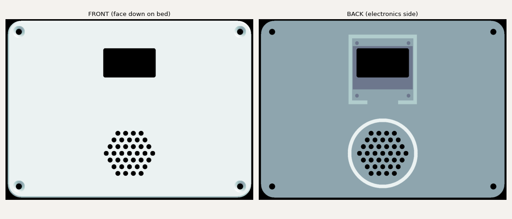
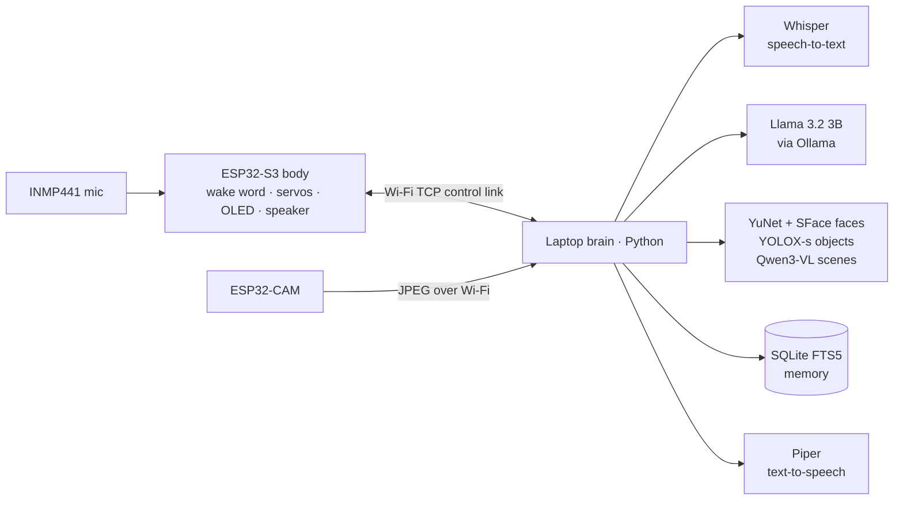

# Rocky – AI desk companion robot

A 3D-printed quadruped that hears "Hey Rocky", talks back, recognises people, sees objects, remembers what you told it and moves. The ESP32-S3 body handles motion, the face and audio; a laptop-side "brain" runs **fully local AI models** (no cloud) and talks to the body over Wi-Fi.

Inspired by Rocky, the alien engineer from *Project Hail Mary*: it even answers like him, short, blunt and technical.

<!-- DEMO: add the demo video (YouTube / GIF) here once recorded -->

## What it does
- **Wake word on the robot itself:** "Hey Rocky" is detected on the ESP32-S3 with a TensorFlow Lite Micro model, so the robot reacts without a cloud call.
- **Conversation with a local LLM:** speech goes to the laptop, gets transcribed, answered by Llama 3.2 and spoken back through Rocky's speaker, with captions on its OLED face.
- **Sees and recognises:** a separate ESP32-CAM board lets Rocky greet known people (face recognition) and answer "what do you see?" (object detection).
- **Remembers:** long-term memory recalls what you actually said, searchable across sessions.
- **Moves and emotes:** 8 servos and 22 poses and tricks (walk, turn, wave, dance, push-ups), plus an expressive eye animation on the OLED.

## Hardware
| Part | Role |
|---|---|
| ESP32-S3 (N16R8) | Body controller: servos, face, audio, wake word, Wi-Fi link |
| 8 × MG90S servos + PCA9685 (I2C) | Legs |
| SSD1306 128×64 OLED | Animated eyes, captions, status bar |
| INMP441 I2S microphone | Voice input and wake word |
| MAX98357A I2S amplifier + speaker | Rocky's voice |
| AI-Thinker ESP32-CAM (OV3660) | Rocky's camera, on its own board |
| 3D-printed body | Adapted from Dorian Todd's [Sesame robot](https://github.com/dorianborian/sesame-robot), modified for Rocky's electronics, plus a custom OLED face panel (`firmware/enclosure/`) |

## How it works

| AI component | Model / tool |
|---|---|
| Wake word | Custom "Hey Rocky" model, TensorFlow Lite Micro on the ESP32-S3 |
| Speech-to-text | Whisper small (mlx-whisper, on the Mac GPU) |
| Conversation | Llama 3.2 3B through Ollama |
| Scene description | Qwen3-VL 2B through Ollama |
| Faces | OpenCV YuNet detector + SFace recogniser |
| Objects | YOLOX-s (COCO, 80 classes) through OpenCV DNN |
| Text-to-speech | Piper (`en_GB-alan-medium`) |

## Problems I hit and how I fixed them
- **The LLM invented memories.** Asked to summarise chats into "facts", the 3B model copied transcripts and made things up. Memory now stores only what the user actually said, verbatim, in SQLite with full-text (BM25) search, and only the relevant snippets are given to the model.
- **Rocky woke itself up.** With no echo cancellation, the mic heard Rocky's own voice and re-triggered the wake word, causing a loop. Fixed with a cooldown after speech and by tuning the detection threshold.
- **The body could get stuck forever.** If the brain crashed mid-reply, the body waited for an answer that never came and stopped listening until power-cycled. A 60 s response timeout, a watchdog and periodic wake-word self-tests now make it recover on its own.
- **USB serial dropped audio.** The control link moved from serial to a Wi-Fi TCP connection with real flow control, which is also a step toward running untethered.
- **The camera froze after long uptime.** A timer-driven watchdog and a periodic self-capture reboot the ESP32-CAM automatically if the sensor stops responding.

## How it was built
I designed the system, built and wired the hardware, and tested and debugged everything on the real robot. Most of the code was written with an AI coding assistant (Claude): I specified what each part should do, ran it on the hardware, and diagnosed failures like the ones above until it worked. I also used AI help for parts of the electronics and design work.

## Repository layout
| Folder | What it is |
|---|---|
| `firmware/` | ESP32-S3 body: 8 servos (PCA9685), OLED face, mic/speaker, on-device "Hey Rocky" wake word, 22 poses/tricks, Wi-Fi control link, OTA updates, enclosure CAD |
| `camera/` | ESP32-CAM firmware: serves pictures to the brain, with OTA updates and a self-healing watchdog |
| `brain/` | Laptop-side Python: speech-to-text, local LLM chat, vision and face recognition, long-term memory, text-to-speech, robot link; tests in `test_*.py` |
| `servo-bench/` | Standalone servo-calibration web page, reusable for any PCA9685/ESP32 project |

## Getting started
1. **Body firmware** – set `WIFI_SSID`, `WIFI_PASSWORD`, `OTA_PASSWORD` in `firmware/src/main.cpp` (and the matching `TOKEN` in `firmware/tools/ota_push.py`), then `cd firmware && pio run -e esp32-s3-devkitc-1 -t upload`.
2. **Camera firmware** – set `WIFI_SSID`, `WIFI_PASSWORD`, `OTA_TOKEN` in `camera/src/main.cpp` (and `TOKEN` in `camera/tools/ota_push.py`), then `cd camera && pio run -e esp32cam -t upload`.
3. **Brain** – install Ollama and pull `llama3.2` and `qwen3-vl:2b-instruct`, download the model files listed in `brain/README.md`, then `cd brain && python3 brain.py`. `python3 diagnose.py --deep` checks every subsystem.
4. **Calibrating servos** – open `http://<board-ip>:8080/control`, or use `servo-bench/index.html`.

Personal data (memory database, face data, recordings) is never committed – see `brain/.gitignore`.

## Limitations and next steps
- The brain runs on a laptop, so Rocky needs it nearby on the same Wi-Fi.
- Hobby micro servos limit walking precision and payload.
- Next: battery power for fully untethered use, and measured wake-word accuracy and response latency.
